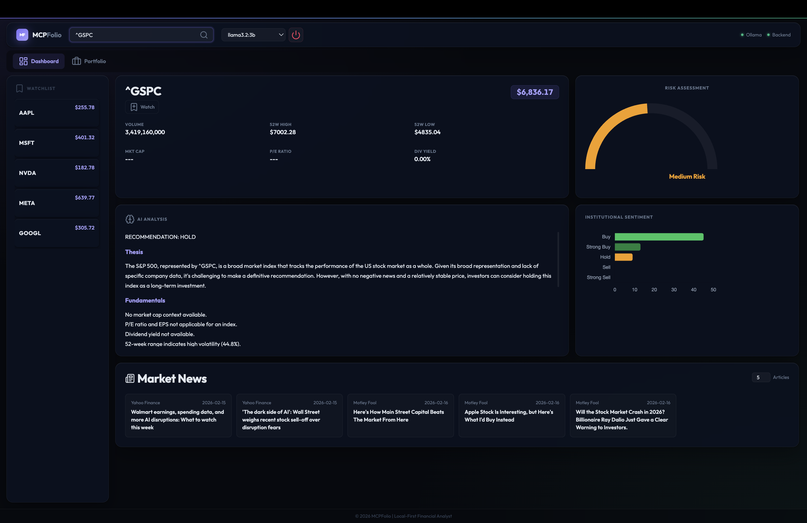
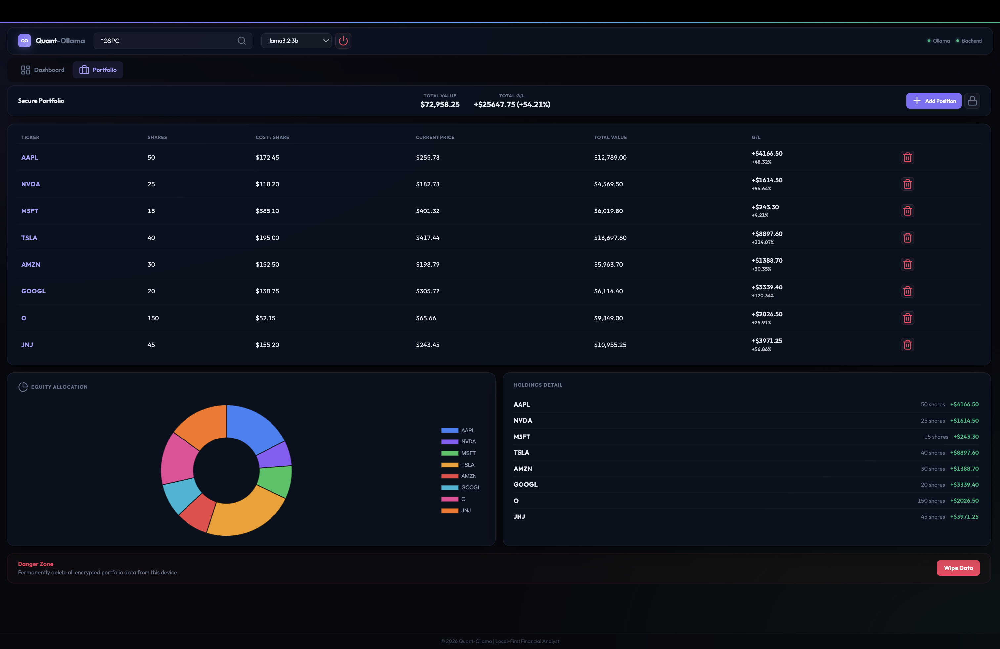

# Quant-Ollama

[](https://github.com/adkarp/quant-ollama-analyst/actions/workflows/ci.yml)
[](https://www.python.org/downloads/)
[](#license)

> **Vibe-coded** in collaboration with [Claude Code](https://claude.ai/code) + [Antigravity](https://antigravity.dev). Vibe-coded PRs are welcome — see [Contributing](#contributing).

**A local-first, privacy-preserving financial analyst powered by a local LLM.**

Quant-Ollama connects a locally-running Ollama model to live market data through the Model Context Protocol (MCP), producing structured risk assessments, AI-written analysis, institutional sentiment breakdowns, and curated news — all without sending your data to any external AI service.

---

| Dashboard | Portfolio |
|---|---|
|  |  |

*Tickers, share counts, and prices shown are illustrative only and do not represent real holdings or investment positions.*

---

## Features

### Dashboard
- **Ticker search** — look up any stock or ETF by symbol; the full analysis pipeline fires on submit
- **Market snapshot** — current price, volume, 52-week high/low, market cap, P/E ratio, dividend yield
- **30-day trend chart** — sparkline of closing prices pulled from yfinance
- **Risk gauge** — a 0–100 composite risk score derived from 52-week volatility (40%), institutional analyst sentiment (30%), and P/E ratio (30%)
- **AI analysis** — structured long-form investment analysis written by the local LLM, rendered as Markdown in-browser
- **Institutional sentiment** — horizontal bar chart of Buy / Strong Buy / Hold / Sell / Strong Sell counts from the most recent analyst ratings period
- **Market news** — up to 20 recent articles fetched per ticker; article count is adjustable live without re-running the full analysis
- **Watchlist sidebar** — bookmark tickers for quick one-click re-analysis; prices persist between sessions

### Portfolio
- **Encrypted local storage** — holdings are encrypted with AES-256 (Fernet) using a PBKDF2-derived key; the password never leaves the device
- **Lock / unlock workflow** — portfolio is locked by default; unlock with your local password each session
- **Add positions** — enter ticker, number of shares, and cost basis per share; total cost is calculated automatically
- **Live G/L tracking** — current prices are batch-fetched in parallel at portfolio open; gain/loss is shown per position and as a portfolio total
- **Equity allocation chart** — doughnut chart showing each holding as a percentage of total portfolio value
- **Holdings detail** — per-ticker share count and dollar gain/loss breakdown
- **Danger zone** — permanently wipe all encrypted portfolio data from the device

### Infrastructure
- **Model picker** — switch between any locally-installed Ollama model at runtime without restarting
- **Health status** — live Ollama and backend status indicators in the header, polled every 10 seconds
- **Graceful shutdown** — shut down both the FastAPI backend and the Ollama process from the dashboard
- **Fund support** — ETF and mutual fund info (top holdings, sector weightings) available via the `get_fund_info` MCP tool
- **Structured JSON logging** — all requests and tool calls logged with timing data for observability
- **CI/CD** — GitHub Actions workflows for tests, dependency updates, and releases

---

## Architecture

```
┌─────────────────────────────────────────────────────────┐
│                    Browser (Vite SPA)                   │
│  Dashboard · Portfolio · Watchlist · Charts · News       │
└───────────────────────┬─────────────────────────────────┘
                        │ REST (HTTP/JSON)
┌───────────────────────▼─────────────────────────────────┐
│              FastAPI Web Server  (src/web/main.py)       │
│  /api/analyze · /api/portfolio · /api/watchlist          │
│  /api/config/models · /api/admin/shutdown                │
└──────────┬──────────────────────┬───────────────────────┘
           │ MCP (stdio)          │ ollama Python client
┌──────────▼───────────┐  ┌──────▼──────────────────────┐
│  MCP Finance Server  │  │  Ollama (local LLM process)  │
│ (src/server/finance) │  │  llama3.2:3b (default)       │
│                      │  │  any installed model         │
│  Tools exposed:      │  └─────────────────────────────┘
│  • get_market_snapshot                                  │
│  • get_sentiment_data                                   │
│  • get_news                                             │
│  • get_trend_data                                       │
│  • get_fund_info                                        │
└──────────┬───────────┘
           │ yfinance + pandas
     Yahoo Finance API
```

### MCP Tools (src/server/finance.py)

| Tool | Description |
|---|---|
| `get_market_snapshot(ticker)` | Current price, volume, 52-week range, volatility, P/E, market cap, dividend yield, analyst targets, quarterly income |
| `get_sentiment_data(ticker, count)` | Recent institutional analyst ratings (Buy / Hold / Sell breakdowns) |
| `get_news(ticker, count, date)` | Recent news articles with title, publisher, link, and published date; optional date filter |
| `get_trend_data(ticker, period)` | Historical OHLCV data formatted for Chart.js (daily, configurable period) |
| `get_fund_info(ticker)` | ETF/mutual fund overview, top holdings, and sector weightings |

All tools are decorated with `@with_retry()` and `@circuit_breaker()` for resilience against yfinance rate limits. Rate limit errors surface as structured messages rather than crashes.

### Risk Score Formula

```
risk_score = clamp(
    (volatility_score × 0.40) +
    (sentiment_score  × 0.30) +
    (pe_score         × 0.30),
    0, 100
)
```

- **Volatility** (52-week price range / low): capped at 100% → mapped 0–100
- **Sentiment**: derived from the buy-to-sell ratio of institutional analyst ratings
- **P/E**: normalized against a 25× baseline; extreme values (negative P/E, >100×) add maximum risk

### Portfolio Encryption

```
password → PBKDF2HMAC(SHA-256, 390 000 iterations, salt) → Fernet key
holdings → JSON → Fernet.encrypt() → base64 → data/portfolio.enc
```

The salt is stored alongside the ciphertext. The password is never persisted. The portfolio file is unreadable without the correct password.

---

## Stack

| Layer | Technology |
|---|---|
| Frontend | Vanilla JS (ES Modules), Vite 7, Chart.js, Lucide icons |
| Backend | Python 3.11+, FastAPI, uvicorn |
| LLM | Ollama (local inference), llama3.2:3b default |
| MCP | FastMCP (stdio transport), langchain-mcp-adapters |
| Data | yfinance, pandas |
| Crypto | cryptography (Fernet / PBKDF2HMAC) |
| Logging | structlog, rotating file handler |
| Config | pydantic-settings (env vars with `QUANT_` prefix) |
| Testing | pytest, pytest-asyncio |
| CI | GitHub Actions |

---

## Requirements

- **Python 3.11+**
- **Ollama** installed and running (`ollama serve`) — see [ollama.com](https://ollama.com)
- **conda** (recommended) or any Python virtual environment manager
- **Node.js 18+** (only needed to rebuild the frontend)

---

## Installation

```bash
# 1. Clone the repository
git clone https://github.com/adkarp/quant-ollama-analyst.git
cd quant-ollama-analyst

# 2. Create and activate the conda environment
conda create -n quant-ollama-analyst python=3.11 -y
conda activate quant-ollama-analyst

# 3. Install Python dependencies
pip install -r requirements.txt

# 4. Pull an Ollama model (llama3.2:3b recommended)
ollama pull llama3.2:3b

# 5. (Optional) Rebuild the frontend
cd src/web/frontend
npm install
npm run build
cd ../../..
```

---

## Running

```bash
conda activate quant-ollama-analyst
python src/main.py

This starts the web server and automatically opens the dashboard in your browser at **http://localhost:8000**.
```

### CLI mode

```bash
python src/main.py --ticker AAPL
```

Runs a single analysis for the given ticker and prints the result to stdout.

### MCP server standalone (for testing)

```bash
python src/server/finance.py
```

Starts the MCP finance server over stdio for direct tool testing.

---

## Configuration

All settings are controlled via environment variables with the `QUANT_` prefix, or via a `.env` file in the project root. See `.env.example` for the full list.

| Variable | Default | Description |
|---|---|---|
| `QUANT_OLLAMA_MODEL` | `llama3.2:3b` | Ollama model name |
| `QUANT_OLLAMA_HOST` | `http://localhost:11434` | Ollama server URL |
| `QUANT_OLLAMA_TIMEOUT` | `120` | LLM request timeout (seconds) |
| `QUANT_OLLAMA_TEMPERATURE` | `0.7` | LLM sampling temperature (0.0–2.0) |
| `QUANT_LOG_LEVEL` | `INFO` | Log verbosity |
| `QUANT_LOG_JSON_FORMAT` | `true` | JSON structured logging |
| `QUANT_DATA_DIR` | `data` | Directory for persistent data (watchlist, portfolio) |
| `QUANT_YFINANCE_CACHE_TTL` | `300` | Market data cache TTL in seconds |
| `QUANT_ENABLE_CORS` | `false` | Enable CORS headers |

---

## Frontend Development

```bash
cd src/web/frontend
npm install
npm run dev      # Hot-reload dev server (proxies /api/* to FastAPI)
npm run build    # Production build → dist/
```

The Vite dev server proxies all `/api/` requests to the FastAPI backend running on port 8000, so both must be running concurrently during development.

---

## Testing

```bash
# Run all tests
pytest

# With coverage
pytest --cov=src --cov-report=term-missing
```

---

## Project Structure

```
quant-ollama-analyst/
├── src/
│   ├── main.py                  # CLI entry point
│   ├── config.py                # Pydantic settings (env vars)
│   ├── prompts.py               # LLM system prompt
│   ├── startup.py               # Startup/shutdown orchestration
│   ├── health.py                # Ollama health check
│   ├── export.py                # Analysis export utilities
│   ├── cli.py                   # CLI argument parsing
│   ├── logging_config.py        # Structured logging setup
│   ├── ollama_pool.py           # Ollama client connection pool
│   ├── server/
│   │   └── finance.py           # MCP finance server (5 tools)
│   ├── graph/
│   │   ├── nodes.py             # LangGraph ReAct nodes
│   │   └── edges.py             # LangGraph state transitions
│   ├── tools/
│   │   ├── lazy_loader.py       # MCP tool lazy initialization
│   │   └── wrappers.py          # @with_retry, @circuit_breaker decorators
│   └── web/
│       ├── main.py              # FastAPI application (~1000 lines)
│       └── frontend/
│           ├── index.html       # SPA shell
│           ├── src/
│           │   ├── main.js      # All frontend logic (~880 lines)
│           │   └── style.css    # Design system (~1200 lines)
│           └── dist/            # Production build output (gitignored)
├── .github/
│   └── workflows/               # CI/CD: tests, dependencies, releases
├── requirements.txt
├── .env.example
└── CLAUDE.md                    # AI assistant project context
```

---

## Licensing

### This project

Quant-Ollama is released into the **public domain**. You may use, copy, modify, and distribute this software for any purpose, without restriction and without attribution requirement.

Where public domain dedication is not legally recognized, the project is licensed under the [Creative Commons Zero v1.0 Universal (CC0-1.0)](https://creativecommons.org/publicdomain/zero/1.0/) license.

### Third-party dependencies

This project depends on software distributed under their own licenses. Notable obligations:

| Dependency | License | Notes |
|---|---|---|
| **Ollama** | [MIT License](https://github.com/ollama/ollama/blob/main/LICENSE) | The Ollama server binary must be separately downloaded from [ollama.com](https://ollama.com). Quant-Ollama communicates with it via its REST API but does not bundle it. |
| **LLM weights** | Varies per model | Models (e.g., Llama 3.2) are downloaded separately via `ollama pull`. Meta's Llama 3 models are subject to the [Meta Llama 3 Community License](https://www.llama.com/llama3/license/). Review the license for your chosen model. |
| **FastAPI** | MIT | |
| **yfinance** | Apache 2.0 | Market data sourced from Yahoo Finance. Subject to Yahoo Finance's [Terms of Service](https://legal.yahoo.com/us/en/yahoo/terms/otos/index.html). Commercial use may require a data license. |
| **Chart.js** | MIT | |
| **Lucide icons** | ISC | |
| **cryptography** | Apache 2.0 / BSD | |
| **LangChain / LangGraph** | MIT | |
| **FastMCP** | MIT | |
| **pandas** | BSD 3-Clause | |

All direct dependencies and their licenses are listed in `requirements.txt`. The frontend CDN-loaded libraries (Chart.js, Lucide, marked.js) are MIT/ISC licensed.

---

## Privacy

- **No data leaves your machine** unless you count yfinance pulling live prices from Yahoo Finance
- The LLM runs entirely locally via Ollama
- Portfolio data is AES-256 encrypted at rest; your password is never written to disk
- No analytics, no telemetry, no API keys required

---

## Contributing

Quant-Ollama was vibe-coded with [Claude Code](https://claude.ai/code) + [Antigravity](https://antigravity.dev) from the ground up. That's not a footnote — it's the intended workflow, and **vibe-coded pull requests are explicitly welcome**.

If you built something cool by prompting an AI pair programmer, opened a terminal, and things worked, that counts. The only bar is that the code works and doesn't break existing behavior. See [CONTRIBUTING.md](CONTRIBUTING.md) for the mechanics.

## Disclaimer

Quant-Ollama is an educational and research tool. Nothing it produces constitutes financial advice. Market data sourced via yfinance may be delayed or inaccurate. Always verify information independently before making investment decisions.
